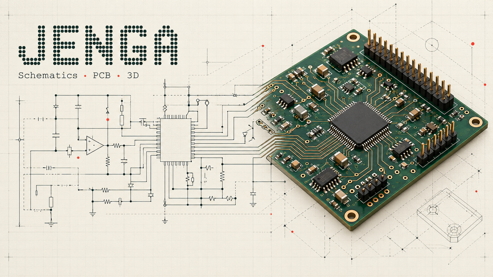

# Jenga



[](https://github.com/JeremyKariukicodesnow/Jenga/actions/workflows/ci.yml)


[](LICENSE)

**An open-source electronics workspace for people and external AI assistants.**

Jenga brings schematic editing, PCB layout, footprint and symbol libraries, and 3D assemblies into a Rust desktop application. Use the interface yourself, or connect an assistant through deterministic MCP, CLI and JSON tools. Jenga does not include a chat model, require an AI subscription, or make engineering decisions on its own.

Created and maintained by **Jeremy ([@JeremyKariukicodesnow](https://github.com/JeremyKariukicodesnow))**, with development assistance from **ChatGPT / OpenAI Codex**. This is an independent project, not an official KiCad or OpenAI product. The header is an AI-generated conceptual illustration, not an application screenshot.

## Status and downloads

**0.8.0 is early-access software for Windows x64.** It is suitable for evaluation and contributions; it is not a guarantee of production-ready PCB designs. Save backups, inspect exports and run native ERC/DRC before relying on a design. Electrical, thermal, mechanical and bench validation remain the designer's responsibility.

[Download latest Windows installer](https://jeremykariukicodesnow.github.io/Jenga/download/?start=1) · [Older versions / all releases](https://github.com/JeremyKariukicodesnow/Jenga/releases) · [0.8.0 early-access release](https://github.com/JeremyKariukicodesnow/Jenga/releases/tag/v0.8.0) · [User guide](docs/USER_GUIDE.md) · [PCB guide](docs/PCB_GUIDE.md) · [Validation evidence and limits](docs/RELEASE_080_VALIDATION.md)

**One permanent download link:** https://jeremykariukicodesnow.github.io/Jenga/download/?start=1 selects the highest published version, including early-access builds, and starts its EXE download. The public 0.8.0 early-access EXE is available now. [Older versions](https://github.com/JeremyKariukicodesnow/Jenga/releases) remain available separately; new releases never replace their original assets.

**Direct 0.8.0 downloads:**

- [Windows installer (.exe)](https://github.com/JeremyKariukicodesnow/Jenga/releases/download/v0.8.0/Jenga-windows-x64-Setup.exe)
- [Matching original source and Rust dependency source](https://github.com/JeremyKariukicodesnow/Jenga/releases/download/v0.8.0/Jenga-0.8.0-source.zip)
- [Checksums](https://github.com/JeremyKariukicodesnow/Jenga/releases/download/v0.8.0/SHA256SUMS)
- [Native runtime notices and source/build access](https://github.com/JeremyKariukicodesnow/Jenga/releases/download/v0.8.0/Jenga-native-10.0.6-NOTICES-SOURCES.zip)

Use the permanent download-page link for the newest published build, including previews. The version-specific links above keep the original 0.8.0 files. GitHub's `/latest` endpoint excludes prereleases; the [sharing/video guide](docs/SHARING_AND_VIDEOS.md) explains website buttons and future stable-release links. No demo video is uploaded yet.

The local build produces an installer, portable ZIP, corresponding Jenga/Rust dependency source ZIP and SHA-256 checksums. **The public [0.8.0 early-access release](https://github.com/JeremyKariukicodesnow/Jenga/releases/tag/v0.8.0) includes its installer, matching original source, checksums and a native-runtime notice/source supplement.** Published release artifacts are frozen; repository main can contain later dependency/CI/documentation changes. See [publication evidence and future release checks](docs/PUBLIC_RELEASE_CHECKLIST.md). Portable archives are available only where explicitly attached to a release. Do not use a source snapshot as an installer or treat an unlisted third-party download as an official build.

The complete Windows package includes symbols, footprints, 3D library data and the native KiCad backend; a separate KiCad installation is not required. This makes the offline package relatively large. Windows binaries are currently unsigned; there is no automatic online updater or established security audit.

## Why Jenga?

Jenga aims to make an electronics task useful in one workspace: draw the circuit, inspect connectivity, make a board, preview the assembly and export the result. For assistants, the same project has explicit tool targets, operation IDs and reviewable changes, reducing fragile screen-clicking and custom Python orchestration. People can still work directly in the desktop interface.

The stable connection bridge addresses a common interruption: after an app upgrade/downgrade, the assistant should recover its worker without the user repeatedly saying “reconnect.” Revision checks and previews protect human edits; they do not guarantee that an AI's electrical choices are correct.

It is a promising, useful prototype with substantial implemented workflows. **It is not perfect:** complex routing, advanced KiCad interoperability, engineering review and clean-machine coverage still need work. More generated tracks or an attractive 3D image do not prove a design is ready to manufacture.

## Requirements

| Requirement | Current position |
| --- | --- |
| Operating system | Windows x64 binary release; Windows 10/11 are the intended desktop targets. Broader clean-machine and driver coverage remains pending. No validated Linux/macOS binary releases yet. |
| Graphics | A working graphics driver for the OpenGL-based desktop renderer. VM/remote-desktop graphics compatibility is not comprehensively tested. |
| Disk | The complete extracted 0.8.0 payload is approximately **4.1 GB**; allow additional space for the download, installer staging, projects and exports. This is a measured payload size, not a universal minimum free-space guarantee. |
| Memory | Depends on board complexity and model size. No verified minimum-RAM figure or controlled performance benchmark is published yet. |
| KiCad | **Not required for the complete Jenga Windows package.** It includes the native backend and symbol, footprint and 3D libraries. A source-only checkout excludes those large binaries/assets and needs preparation steps. |
| AI | Optional. Manual editing requires no AI account or API key. Automation requires a local-capable assistant/client; its own provider/account and network requirements apply. |
| Internet | Not needed for local editing with the complete offline package. Needed for downloads, web asset discovery and any externally hosted assistant that requires it. |

Installing a binary does not require Rust or compiler tools; those are development requirements only. Download all of the portable package, rather than copying just Jenga.exe.

## What you can do

| Area | Available workflows |
| --- | --- |
| Schematics | Place and edit symbols; draw full wires, junctions and labels; manage independent drawings and hierarchical sheets; inspect connections and export drawings. |
| PCB | Create independent boards or optionally link a schematic; place footprints, route copper, manage layers/zones, inspect findings and export manufacturing data. |
| Libraries | Create/edit custom symbols and footprints; attach 3D models; import native assets into a project or personal library. |
| 3D | Inspect the assembly in a tab or separate window, adjust brightness/ambient light, export camera PNG/PDF views and supported CAD model formats. |
| Automation | MCP/CLI/JSON discovery, revision-guarded previews and commits, compact inspection, background calculations, progress/cancellation and durable operation receipts. |
| KiCad exchange | Open modern native projects/files; import projects or independent documents; exchange supported clipboard objects while preserving unknown fields in native files. |

Compatibility is incremental. Legacy `.sch`, every historic KiCad version and every advanced clipboard object are **not** supported. Unsupported clipboard objects are reported rather than silently discarded. Complete hierarchical projects use whole-project import. Jenga's approximate checks do not replace native DRC for complex rules. See the validation report for the precise test boundaries.

## Get started

When a verified binary release becomes available:

1. Download the versioned installer or portable ZIP and its `SHA256SUMS` from this repository's Releases page.
2. Check the downloaded hash, for example `Get-FileHash .\Jenga-0.8.0-windows-x64-Setup.exe -Algorithm SHA256`.
3. Run the installer, or extract the complete portable ZIP and launch `Jenga/Jenga.exe`.
4. Create/open a project, then add a schematic, PCB, or both. Linking a board to a schematic is optional.

For existing installations, Setup offers Upgrade, Repair or Downgrade and preserves project/personal data. Save work before maintenance. Keep a backup before downgrading a project made with newer features.

### Connect an assistant

Use **Connect Assistant** or the installed CLI:

```powershell
jenga-cli setup --client Codex --workspace "$env:USERPROFILE\Documents" --install --skill
```

Setup registers a stable `jenga-connect.exe` bridge outside the replaced application directory. Existing assistants need one restart to adopt it. Later worker upgrades/downgrades reconnect automatically without a new pasted configuration. Hosts that cannot refresh MCP tool lists may still need a restart. Interrupted edits are never replayed blindly: inspect the retained operation ID, then reopen the intended saved document if needed.

**Assistant setup:** built-in registration helpers cover Codex, Claude Code, Cursor and Antigravity. Other local MCP stdio clients can use the generated generic configuration; assistants with local command execution can use the CLI/JSON API. Browser-only chat does not automatically have access to local Jenga files. See [which assistants and setup recipes](docs/AI_ASSISTANTS.md).

The assistant supplies the engineering reasoning. The bundled skill covers exact part/datasheet evidence, power budgets, full visible wiring, readable labels, ground/antenna review and reusing appropriately licensed manufacturer/community assets. See [automation](docs/AUTOMATION.md) and the [skill](docs/assistant-skill/jenga-design/SKILL.md).

## Build from source

Install a current stable Rust toolchain (dependency MSRVs apply), Windows MSVC build tools and Git. The current desktop/release validation target is Windows x64.

```powershell
cargo test --workspace --locked
cargo run -p jenga-desktop
```

The repository includes font source and small fixtures, but deliberately excludes gigabytes of binary libraries, backend binaries, local settings, caches and personal projects. For a complete offline Windows package, obtain official KiCad 10 libraries/backend locally, then run:

```powershell
./scripts/prepare-libraries.ps1 -KiCadRoot 'C:\Program Files\KiCad\10.0'
./scripts/prepare-pcb-backend.ps1 -KiCadRoot 'C:\Program Files\KiCad\10.0'
./scripts/build-release.ps1
```

Inno Setup is needed to create Setup.exe. Audit redistribution notices/source availability before publishing a bundle. A dependency-vendored source archive accompanies binary releases; full offline library assets have separate provenance/licenses.

## Collaborate

Start with [CONTRIBUTING.md](CONTRIBUTING.md), [CODE_OF_CONDUCT.md](CODE_OF_CONDUCT.md) and [GOVERNANCE.md](GOVERNANCE.md). Fork, create a focused branch, add meaningful tests and open a pull request. Public visibility does not grant write or merge access. The maintainer controls upstream membership, merging, tags and releases; branch protection requires review and passing checks.

Report ordinary bugs with a minimal redistributable fixture. **Do not post credentials, personal projects or private security findings in public issues.** Follow [SECURITY.md](SECURITY.md) for vulnerabilities. AI-assisted contributions are welcome when reviewed and tested by the human contributor, with sources and limitations disclosed.

## Versioning and roadmap

`Cargo.toml` is the version source of truth. This release remains **0.8.0**. Tags use `v0.8.0`; release labels distinguish drafts, early-access prereleases and stable releases without silently changing the application's version.

Before 1.0, minor versions may change preview APIs. Existing projects must remain protected by explicit migrations and backups. Patches contain fixes; minors add features; a future 1.0 requires a documented compatibility/support commitment. Never replace published release assets silently. See [CHANGELOG.md](CHANGELOG.md) and [release policy](docs/RELEASING.md).

Next priorities are broader KiCad interoperability fixtures, clean-machine validation, independent engineering review, code signing, third-party distribution completeness and measured performance benchmarks.

## License and acknowledgements

Jenga's code is licensed under **GPL-3.0-or-later**, subject to the separately identified third-party material. Commercial use is allowed under the applicable licenses; this is not a proprietary license or an exclusive ownership claim over upstream work.

Thank you to the **KiCad developers, library contributors, Vladimir Uryvaev and NewStroke contributors**, and the maintainers of Rust dependencies and native runtime dependencies. The NewStroke source is included with its notices; KiCad libraries and backend have their own distribution obligations. See [THIRD_PARTY_NOTICES.md](THIRD_PARTY_NOTICES.md), [AUTHORS.md](AUTHORS.md) and [LICENSE](LICENSE).

No warranty is provided. Jenga is not affiliated with or endorsed by KiCad or OpenAI. Attribution, tests and a license do not substitute for a security audit, license compliance review or hardware validation.
